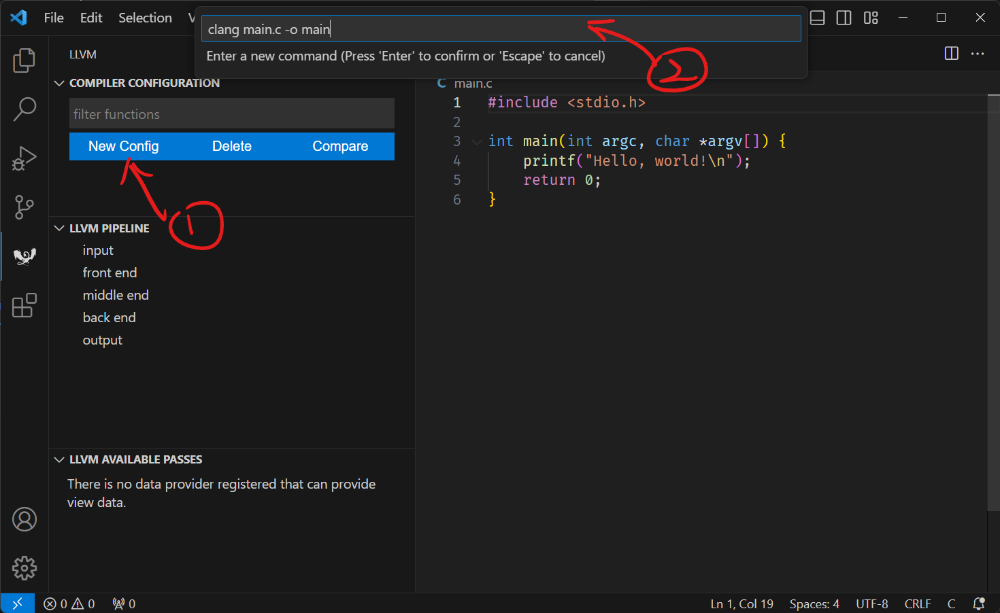
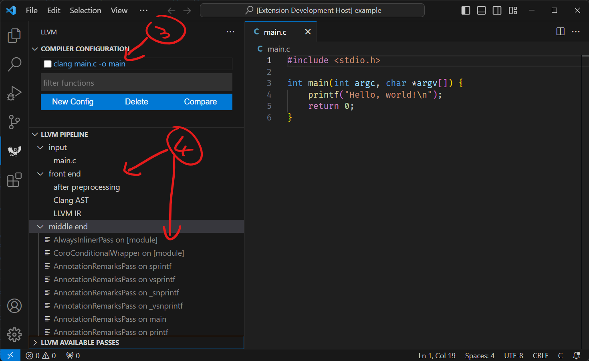
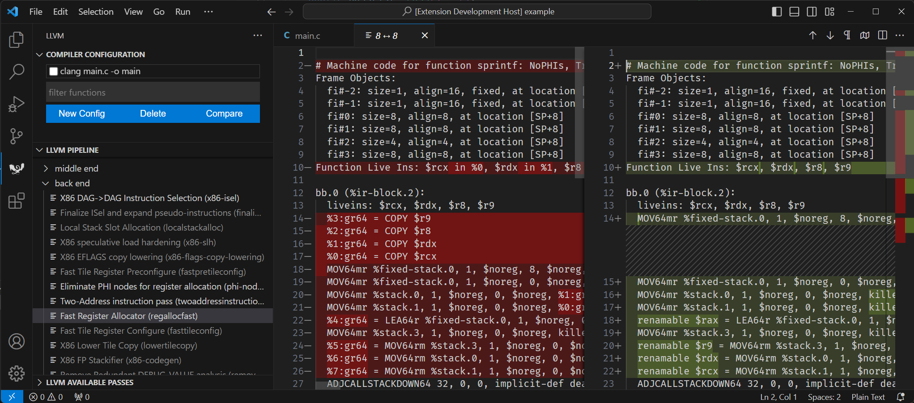
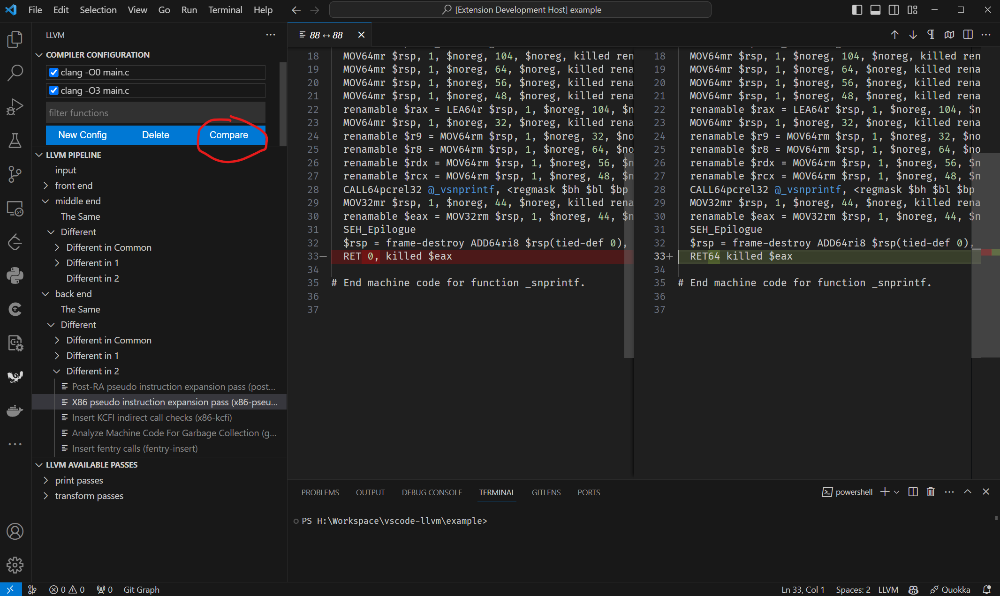
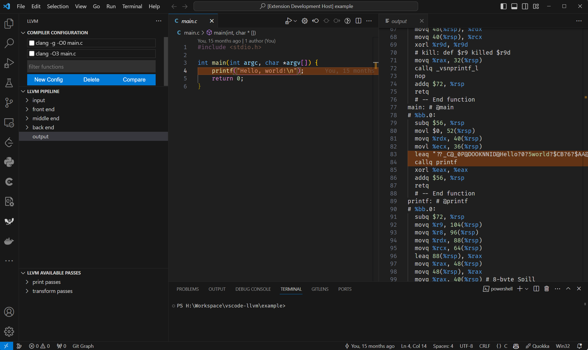
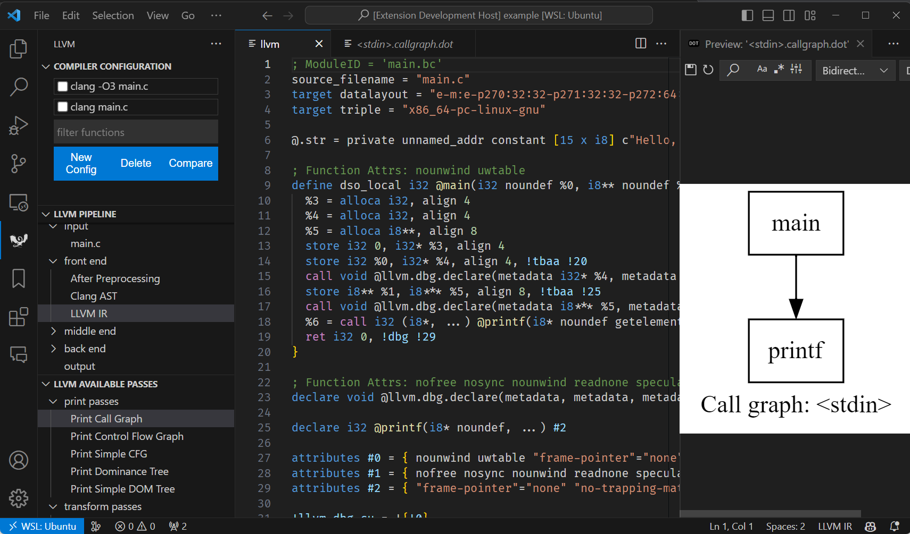

# VSCode LLVM Compiler Explorer
Download from [VSCode marketplace](https://marketplace.visualstudio.com/items?itemName=XiaofanSun.vscode-llvm).

This is a tool for compiler developers of LLVM. This vscode extension can support exploring LLVM IR and machine IR after each pass. 

## Features

1. Run a clang command and explore preprocessing phase, clang AST building phase, each phase of LLVM passes, and final generated assembly code.
2. Compare difference between IRs before and after running a pass.
3. Support custom clang or modified version.

## How to use

1. Click 'New config' for creating a new configuration
2. Type your command to compile the file

3. (Optional) If you want to focus on one function. You can type the function name in the 'filter function' field. Please note, this function name should be mangle name if it's C++. Then, click the command name to run the command.
4. Now, you can explore the IRs after each pass.

## Compare Mode

To debug a pass, you may want to compare a clang command with and without the pass. Or you want to debug a different version of clang with the stable version. This extension can help you to compare the difference between two IRs after each pass.

## Source2Asm Mapping View

Inspired by Compiler Explorer, this extension can highlight the mapping between source code and the assembly code.

## Run Print Pass to View CallGraph/CFG/DOMTree

There is a list of utility passes available in this plugin. You can run these passes to view the CallGraph, CFG, and DOMTree of an IR file.

When you open an IR file, you can click the 'Print Call Graph' button to generate a callgraph.dot file. Then, you can use the Graphviz plugin to view the callgraph.

Note: You need to have 'opt' tool in your PATH (or specify the path in settings) and installed [Graphviz preview plugin](https://marketplace.visualstudio.com/items?itemName=tintinweb.graphviz-interactive-preview).

## Syntax Highlighting

This plugin provides syntax highlighting for Clang AST and assembly language. You may need to install additional LLVM syntax highlighting plugins, there are some options:

- [RReverser.llvm](https://marketplace.visualstudio.com/items?itemName=RReverser.llvm)
- [colejcummins.llvm-syntax-highlighting](https://marketplace.visualstudio.com/items?itemName=colejcummins.llvm-syntax-highlighting)

## Live updates

After running a pipeline, keep an assembly, AST, LLVM IR, preprocessed source,
or pass comparison editor visible next to the input. Editing the input refreshes
visible results after a 300 ms pause, including changes that have not been saved.
Clang reads the editor buffer through a temporary VFS overlay, preserving the
original source path and relative includes without writing the source file.

Live refreshes run in the background and serialize work per pipeline. Results
from an older edit are discarded. A compilation error leaves the last successful
result visible; editing valid code triggers another refresh. Hidden result views
are deferred until shown again. AST, preprocessing, and LLVM IR commands run only
for visible views; full pass dumps are requested only for visible pass comparisons.
The explicit Run command still builds the complete pipeline and pass list.

Unsaved-buffer compilation currently supports Clang driver commands. Other
command types refresh from disk when their input path is available. Changes to
included headers are not tracked automatically.

Run the focused live-update regression tests with `npm run test:live` (Node 18+).

To include the real compiler test, set `LLVM_TEST_CLANG` to an absolute Clang
executable path before `npm run test:live`. Without it, that test is skipped.
To run the focused VS Code integration test, set `LLVM_TEST_CLANG`,
`LLVM_TEST_GLOB='**/live.test.js'`, and optionally `VSCODE_EXECUTABLE_PATH` to an
existing VS Code executable, then run `npm run compile-tests && npm run runtest`.
Linux extension-host tests require a display (for example Xvfb).
